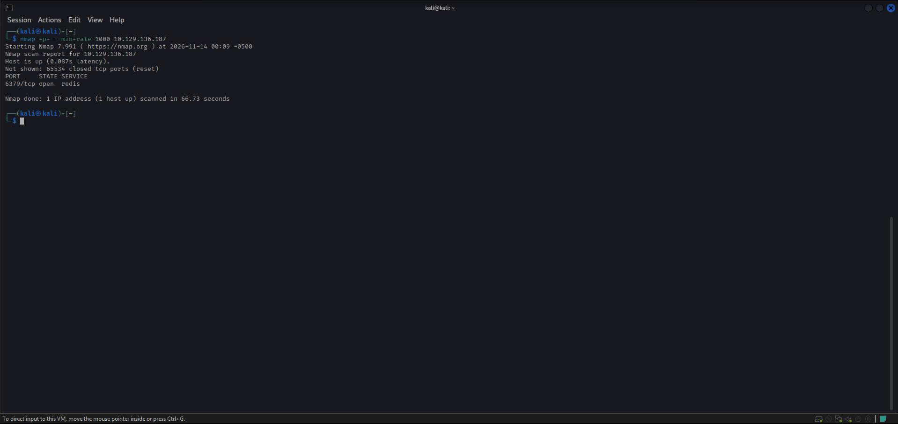
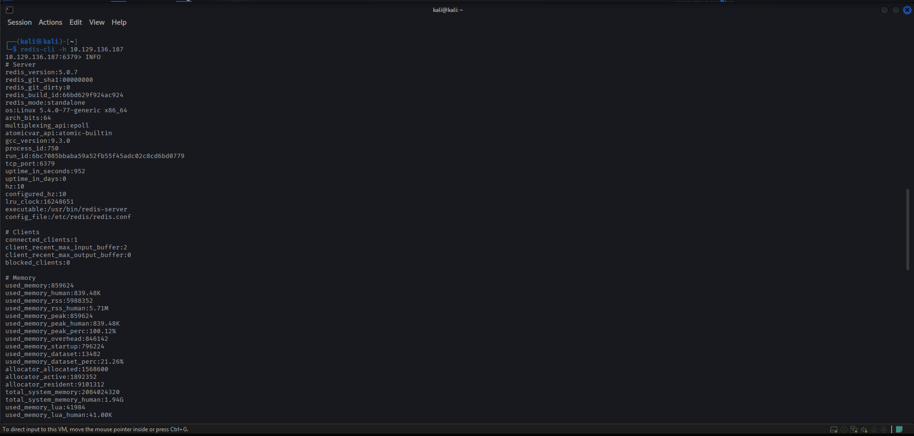
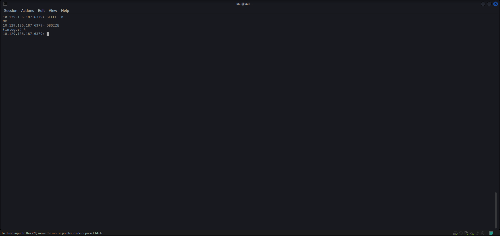
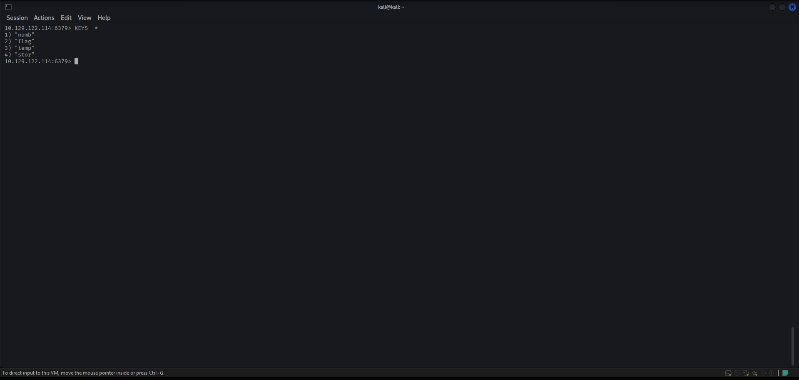
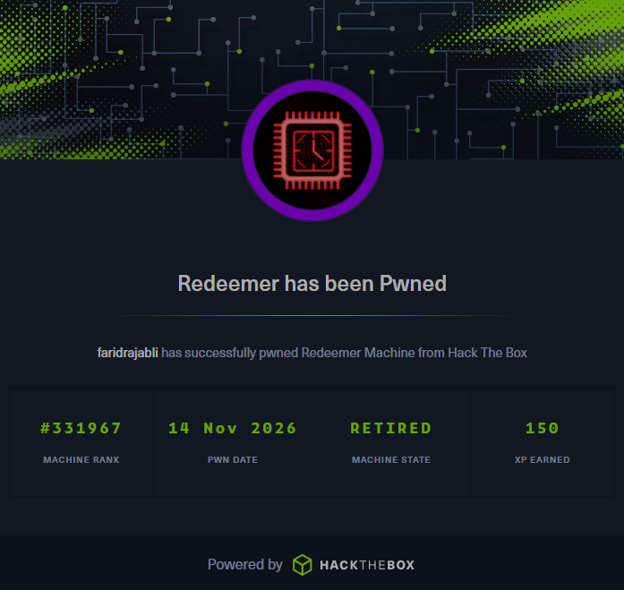

# HTB Starting Point – Redeemer

**Status:** Completed  
**Difficulty:** Very Easy  
**Tier:** 0  
**Platform:** Hack The Box  
**Operating System:** Linux  
**Main Topic:** Redis

## Objective

The objective of this lab was to identify an exposed Redis service, connect to the server, explore its database, and retrieve a stored value.

## Tools Used

- Nmap
- Redis CLI
- Kali Linux Terminal

## Enumeration

I started by scanning all TCP ports on the target machine to identify open services.

```bash
nmap -p- --min-rate 1000 10.129.136.187
```

The scan identified TCP port `6379` as open, running Redis.

## Redis Service Enumeration

I connected to the Redis server using Redis CLI:

```bash
redis-cli -h 10.129.136.187
```

To obtain information and statistics about the server, I executed:

```redis
INFO
```

The server information revealed the following:

| Detail | Result |
|---|---|
| Service | Redis |
| Port | 6379/tcp |
| Redis Version | 5.0.7 |
| Operating System | Linux |
| Redis Mode | Standalone |

## Database Enumeration

I selected database 0:

```redis
SELECT 0
```

Then I checked the number of keys:

```redis
DBSIZE
```

The database contained 4 keys.

To list all available keys, I used:

```redis
KEYS *
```

The following keys were discovered:

- numb
- temp
- stor
- flag

## Data Retrieval

I identified the `flag` key and retrieved its stored value using:

```redis
GET flag
```

The flag value is intentionally excluded from this public report.

## Key Findings

- Redis was exposed on TCP port 6379.
- The Redis server was running version 5.0.7.
- I was able to connect to the Redis service without providing authentication credentials.
- Database 0 contained four keys.
- The database exposed a stored flag value.

## SOC Analyst Perspective

This lab demonstrates the security risks of exposing Redis services without appropriate access controls.

Recommended security measures:

- Require authentication and use appropriate access controls.
- Restrict Redis access to trusted networks.
- Avoid exposing Redis directly to the public internet.
- Monitor unusual connections and database commands.
- Keep Redis updated to a supported version.
- Review Redis configuration and network firewall rules.

## What I Learned

- How to identify Redis services using Nmap.
- How to connect to Redis using `redis-cli`.
- How to retrieve server information using `INFO`.
- How to select a database using `SELECT`.
- How to enumerate database keys using `DBSIZE` and `KEYS`.
- How to retrieve a stored value using `GET`.
- Why exposed database services create security risks.

## Evidence

### 1. Nmap Scan



### 2. Redis Server Information



### 3. Database Key Count



### 4. Machine Completion



### 5. HTB Achievement Badge



