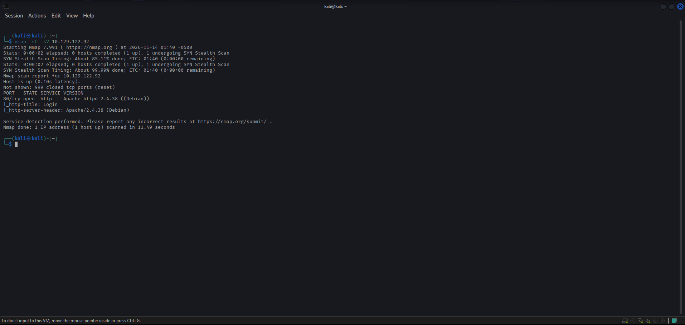
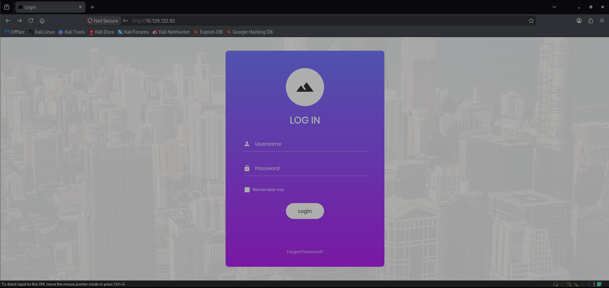
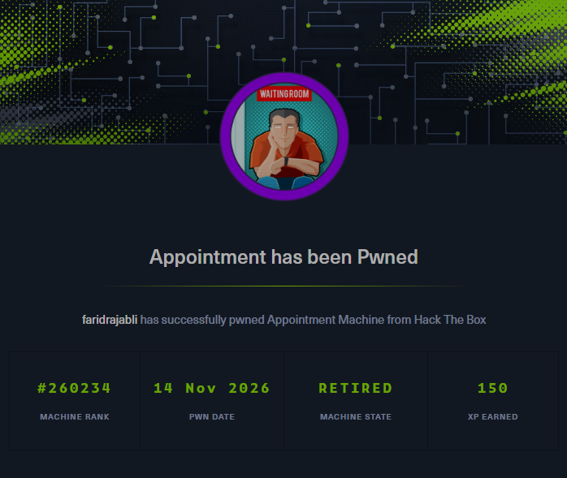

# Appointment

**Platform:** Hack The Box  
**Category:** Starting Point – Tier 1  
**Operating System:** Linux  
**Target IP:** `10.129.122.92`  
**Status:** Completed

## Overview

Appointment is a beginner-friendly web application security lab focused on SQL Injection. The objective was to identify the web service, understand the login functionality, and exploit an SQL Injection vulnerability to bypass authentication.

## Tools Used

- Nmap
- Web Browser

## Enumeration

An Nmap scan was performed to identify open ports and running services.

```bash
nmap -sC -sV 10.129.122.92
```

**Results:**

| Port | Service | Version |
|---|---|---|
| 80/tcp | HTTP | Apache httpd 2.4.38 (Debian) |

The web server hosted a login page.



## SQL Injection

The login page was vulnerable to SQL Injection due to improper handling of user input.

The following input was used in the username field to bypass authentication:

```sql
admin'#
```

The `#` character comments out the remaining part of the SQL query in MySQL, allowing the login check to be bypassed without knowing the password.



## Security Findings

- The login form was vulnerable to SQL Injection.
- User input was not properly validated or handled.
- Authentication could be bypassed without valid credentials.

## Defensive Recommendations

- Use parameterized queries (prepared statements).
- Avoid building SQL queries through direct string concatenation.
- Apply proper input validation.
- Use database accounts with least-privilege permissions.
- Perform regular security testing of web applications.

## Key Takeaways

- Identified HTTP services using Nmap.
- Learned how SQL Injection can affect authentication mechanisms.
- Practiced a MySQL comment-based authentication bypass.
- Understood the importance of secure database query handling.

## Achievement


