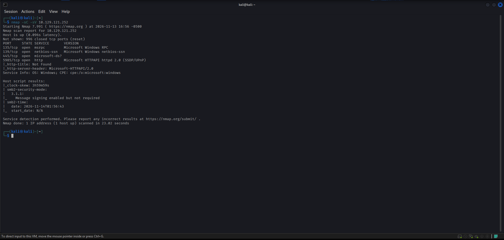
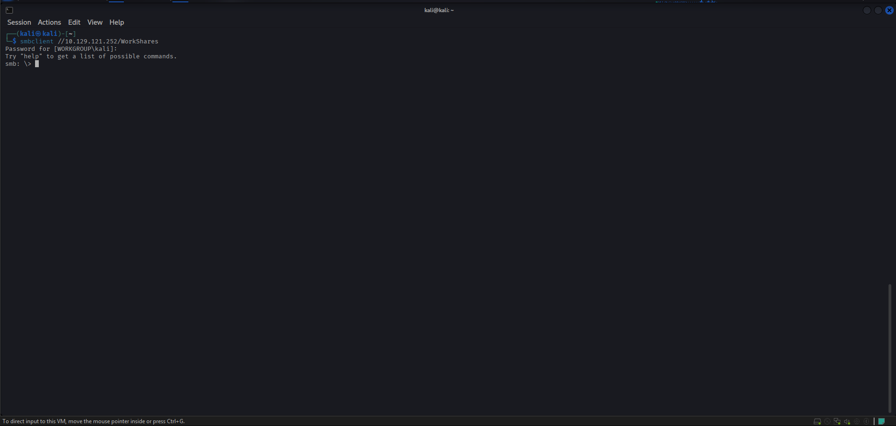
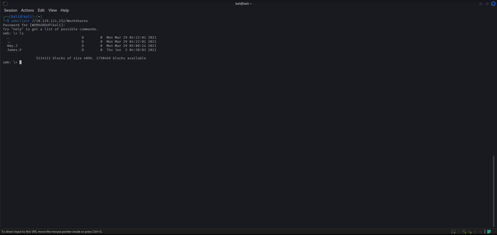
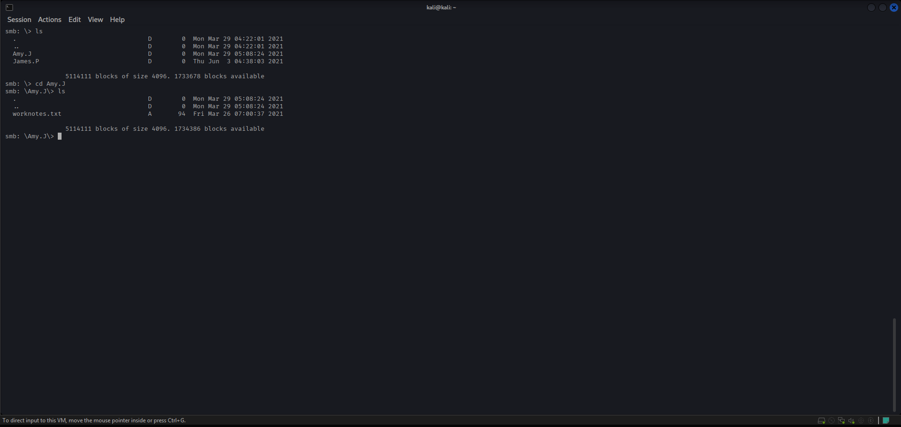
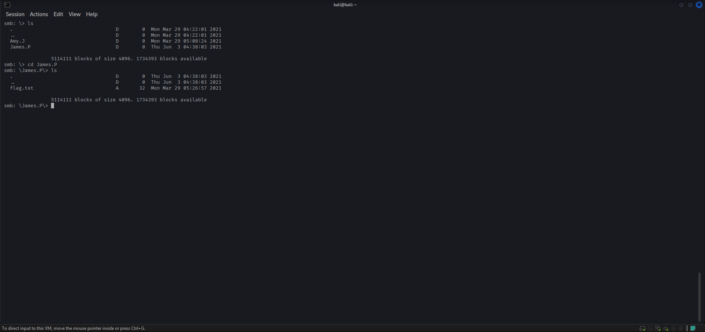

# HTB Starting Point – Dancing

<badge>Completed</badge> <badge>Tier 0</badge>

## Machine Information

| Detail | Information |
|---|---|
| Platform | Hack The Box |
| Machine | Dancing |
| Difficulty | Very Easy |
| Tier | 0 |
| Operating System | Windows |
| Main Topic | SMB (Server Message Block) |
| Status | Pwned |

## Objective

The objective of this lab was to explore SMB services, enumerate available network shares, access an accessible share, and retrieve a file.

## Tools Used

- Nmap
- smbclient
- Linux Terminal

## Enumeration

I started by scanning the target machine with Nmap to identify open ports and running services.

```bash
nmap -sC -sV 10.129.121.252
```

The scan identified SMB running on TCP port 445.

## SMB Share Enumeration

I used `smbclient` to list the available SMB shares:

```bash
smbclient -L 10.129.121.252
```

The following shares were discovered:

- ADMIN$
- C$
- IPC$
- WorkShares

## Accessing the WorkShares Share

I connected to the `WorkShares` share:

```bash
smbclient //10.129.121.252/WorkShares
```

The share allowed access without providing a password.

Inside the share, I discovered two directories:

- Amy.J
- James.P

## File Discovery and Retrieval

I explored both directories and identified files available for retrieval.

In the `Amy.J` directory, I found `worknotes.txt` and downloaded it using:

```bash
get worknotes.txt
```

The file contained internal work notes.

In the `James.P` directory, I found `flag.txt` and retrieved it using:

```bash
get flag.txt
```

The flag value is intentionally excluded from this public report.

## Key Findings

- SMB was accessible over TCP port 445.
- Multiple SMB shares were exposed.
- The `WorkShares` share allowed access without a password.
- User directories and files were accessible through the share.

## SOC Analyst Perspective

From a defensive perspective, this lab demonstrates the risks of improperly configured SMB shares.

Recommended security measures:

- Restrict anonymous and guest SMB access.
- Apply the principle of least privilege.
- Review SMB share and NTFS permissions.
- Monitor access to shared folders.
- Restrict TCP port 445 to trusted networks.
- Disable SMBv1 if it is enabled.

## What I Learned

- How to identify SMB services using Nmap.
- How to enumerate SMB shares with `smbclient`.
- How to access an SMB share.
- How to navigate directories and retrieve files.
- Why proper SMB permissions are important for network security.

## Evidence

### 1. Nmap Scan



### 2. SMB WorkShares Access



### 3. Discovered Directories



### 4. Work Notes



### 5. File Retrieval



### 6. HTB Achievement


## HTB Achievement
